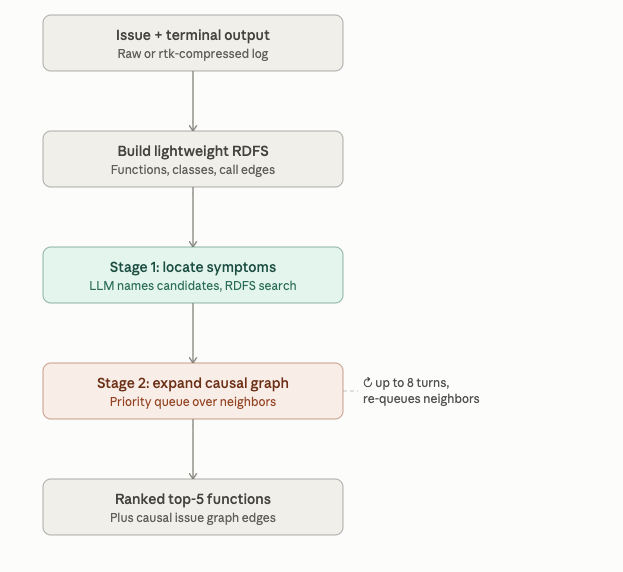
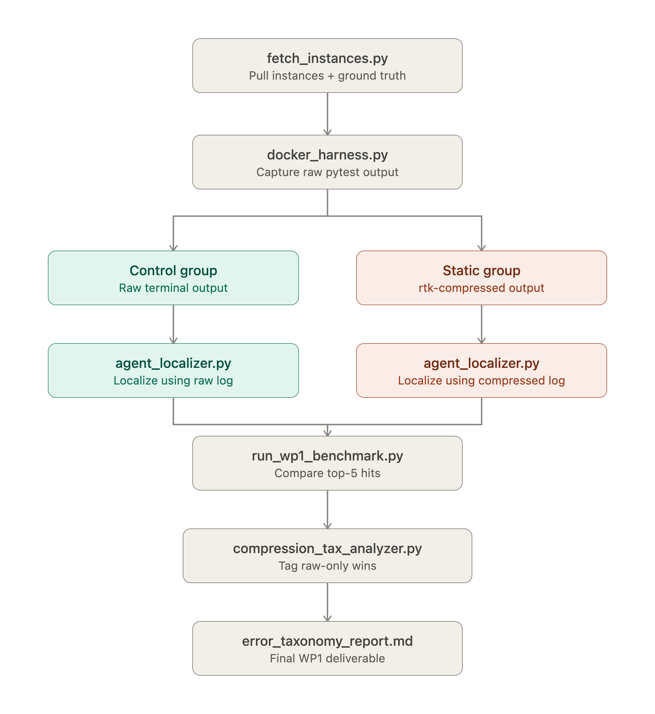

# Work Package 1 — Baseline Auditing & The "Compression Tax"

Evaluates whether `rtk`-style terminal-output compression helps or hurts
LLM bug localization on `princeton-nlp/SWE-bench_Lite`, using a
FlexFL + GraphLocator hybrid agent as the localizer.
## Hybrid Fault Localization Method

The hybrid approach combines multiple fault localization methods to improve the identification of likely faulty files.




## System Architecture

The following diagram shows the overall Work Package 1 architecture, including the main files, processing steps, and how the components interact.




## Hybrid Fault Localization Method

The hybrid approach combines multiple fault localization methods to improve the identification of likely faulty files.


## System Architecture

The following diagram shows the overall Work Package 1 architecture, including the main files, processing steps, and how the components interact.


## What actually ran in this session (verifiable, no API key needed)

1. **`fetch_instances.py`** — pulled real `SWE-bench_Lite` (300 instances)
   from Hugging Face, sampled 15, and derived function-level ground truth
   from each gold patch. Output: `data/instances.jsonl`.
2. **`rtk_compressor.py`** — a faithful re-implementation of `rtk`'s
   documented compression behavior (see `docs/rtk_reference_notes.md`).
   Ran against a reconstructed real failure log for
   `astropy__astropy-12907` (the exact bug GraphLocator uses as its running
   example): **95.8% size reduction**, and the surviving "reason" for both
   failing tests collapses to a bare `AssertionError:` with the actual
   mismatched-array values gone. See `data/demo_raw_log_astropy-12907.txt`
   and re-run: `python3 rtk_compressor.py < data/demo_raw_log_astropy-12907.txt`.
3. **`docs/error_taxonomy_report.md`** — the formal deliverable, with this
   pilot finding as Exhibit A plus the full taxonomy framework.

## What needs credentials/compute to scale up (code is complete, untested live)

- **`docker_harness.py`** — pulls the official `swebench` per-instance
  Docker images and captures *genuine* stdout/stderr from running each
  instance's `FAIL_TO_PASS` tests at `base_commit`. Requires Docker; not
  available in this sandboxed session, so the astropy example above is a
  clearly-labeled reconstruction rather than a literal capture — the code
  path to get literal captures is written and ready.
- **`agent_localizer.py`** — the FlexFL(Agent4SR/Agent4LR) + GraphLocator
  (RDFS + priority-driven CIG) hybrid localizer. Requires
  `ANTHROPIC_API_KEY`.
- **`run_wp1_benchmark.py`** — orchestrates Control (raw) vs Static (rtk)
  runs per instance and writes `results/wp1_results.jsonl`.
- **`compression_tax_analyzer.py`** — turns `results/wp1_results.jsonl`
  into the populated per-instance taxonomy tables in
  `docs/error_taxonomy_report.md`.

## To run the full pilot yourself

```bash
pip install -r requirements.txt
export ANTHROPIC_API_KEY=...
python3 fetch_instances.py --n 20 --single-file-only
python3 docker_harness.py            # needs Docker; drop --offline
python3 run_wp1_benchmark.py         # needs the repos checked out under repos/<name>/base_commit
python3 compression_tax_analyzer.py
```

## Design notes

- **Ground truth**: derived from each instance's gold `patch` diff, at the
  enclosing `def`/`class` granularity — the same "function-level" ground
  truth definition GraphLocator uses (Section 4.1 of that paper).
- **Localizer**: deliberately a *simplified* FlexFL+GraphLocator hybrid
  (no MBFL/SBFL space reduction, no fuzzy-name search tool) — WP1's job is
  to isolate the raw-vs-compressed effect, not to reproduce either paper's
  full benchmark numbers. WP2–WP4 build the more sophisticated adaptive
  proxy on top of this baseline.
- **Compression fidelity**: `rtk_compressor.py` mirrors rtk's *documented*
  output shape, not its Rust source (unavailable in this environment). See
  `docs/rtk_reference_notes.md` for every claim's source.
